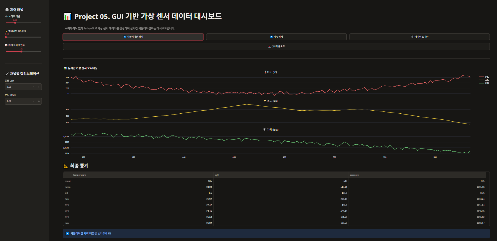

# 📊 Project 05. GUI 기반 가상 센서 데이터 통합 대시보드

> 🤖 **아두이노 없이** Python으로 가상 센서 데이터를 생성하여  
> **Streamlit + Plotly**로 실시간 시뮬레이션하는 교육용 대시보드

---

## 🌐 배포 링크

[](https://suyeong0627-project05-dashboard.streamlit.app/)

👉 **[앱 바로가기](https://suyeong0627-project05-dashboard.streamlit.app/)**

---

## 💡 프로젝트 개요

- 아두이노 없이 **순수 Python**으로 가상 센서 데이터 생성
- 실시간 **3채널 센서 모니터링** 대시보드
- 데이터 기록 및 **CSV 다운로드** 기능
- **이상치 자동 감지** 및 경고 알림

---

## 🛠 사용 기술 스택

| 분류 | 기술 | 용도 |
|------|------|------|
| 🖥️ Frontend | `Streamlit` | 웹 인터페이스 구성 |
| 📊 시각화 | `Plotly` | 실시간 3채널 차트 렌더링 |
| 🔢 데이터 처리 | `NumPy`, `Pandas` | 가상 센서 신호 생성 및 처리 |
| 📥 저장 | `CSV` | 측정 데이터 다운로드 |
| ☁️ 배포 | `Streamlit Cloud` | 무료 클라우드 호스팅 |
| 🐍 언어 | `Python 3.10+` | 전체 로직 |

---

## 📸 앱 미리보기

### 📡 실시간 3채널 센서 대시보드


## 📂 프로젝트 구조

```
project05-dashboard/
├── app.py               # 메인 Streamlit 대시보드
├── requirements.txt     # 패키지 의존성 목록
└── README.md            # 프로젝트 설명 (이 파일)
```

---

## ⚙️ 주요 기능

### 📡 실시간 시뮬레이션 제어

| 기능 | 설명 |
|------|------|
| ▶️ 시작 / ⏸️ 정지 | 가상 센서 시뮬레이션 ON/OFF |
| 🔴 기록 시작 / ⏹️ 정지 | 데이터 기록 ON/OFF |
| 🗑️ 데이터 초기화 | 전체 기록 데이터 리셋 |
| 📥 CSV 다운로드 | 기록된 센서 데이터 즉시 내보내기 |

### ⚙️ 사이드바 제어 패널

| 설정 | 범위 | 기본값 | 설명 |
|------|------|--------|------|
| 🔊 노이즈 레벨 | 0.0 ~ 3.0 | 0.5 | 센서 신호 노이즈 강도 조절 |
| ⚡ 업데이트 속도 | 0.1 ~ 1.0초 | 0.3초 | 차트 갱신 주기 조절 |
| 📈 최대 표시 포인트 | 50 ~ 300 | 150 | 차트에 표시할 최대 데이터 수 |
| ⚖️ 온도 Gain / Offset | 실수 입력 | 1.0 / 0.0 | 채널별 캘리브레이션 계수 |

### 🚨 이상치 자동 감지

| 채널 | 정상 범위 | 이상치 조건 |
|------|-----------|-------------|
| 🌡️ 온도 | 20 ~ 28°C | 범위 초과 시 경고 |
| 💡 조도 | 150 ~ 850 lux | 범위 초과 시 경고 |
| 🌪️ 기압 | 1009 ~ 1017 hPa | 범위 초과 시 경고 |

---

## 📊 가상 센서 신호 설명

**🌡️ 온도 (22~26°C)**
- 긴 주기 사인파로 목표값 설정
- 이전 값에서 조금씩만 이동 (급격한 점프 없음)
- Gain / Offset 캘리브레이션 적용 가능

**💡 조도 (300~700 lux)**
- 빠른 주기 사인파 혼합 신호
- 조금 더 역동적인 변화 패턴 시뮬레이션

**🌪️ 기압 (1010~1016 hPa)**
- 매우 천천히 변하는 장주기 신호
- 실제 기압 변화 패턴 모방

---

## 🚀 로컬 실행 방법

**1단계: 저장소 클론**

```bash
git clone https://github.com/suyeong0627/project05-dashboard.git
cd project05-dashboard
```

**2단계: 패키지 설치**

```bash
pip install -r requirements.txt
```

**3단계: 앱 실행**

```bash
streamlit run app.py
```

브라우저에서 `http://localhost:8501` 접속!
